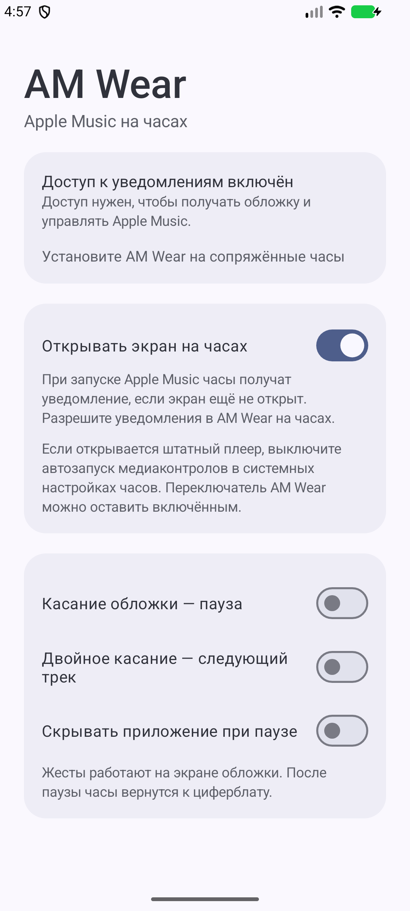

# AM Wear

[Русский](README.ru.md) · [Download APKs](https://github.com/sad-akulka/am-wear/releases/latest)

AM Wear is an unofficial Apple Music companion for Wear OS. Play music in Apple Music on your Android phone and see the current album cover on your watch. The clock and controls take their colors from the artwork.

| Now playing | Playback controls | Always-on Display |
| :---: | :---: | :---: |
|  |  |  |

The screenshots use the supplied artwork from Jennie's *Ruby* as a demo for “Seoul City”.

## What it does

- Shows album artwork full-screen with the time, track title and artist. Artwork and accent colors crossfade when the track changes.
- Turn the bezel or crown, or swipe up, to reveal previous, play/pause and next controls over blurred artwork. Turn back or swipe down to return to the cover.
- On watches with color Always-on Display, the dimmed cover and track details stay on screen and can update while the watch is asleep. On watches with two-color ambient mode, AOD shows the clock and text.
- When Apple Music starts playing, AM Wear requests that the watch open its player. If Wear OS keeps it in the background, the watch can show a notification that opens it.

## Install

The phone companion uses Material You, follows the system light/dark theme and adopts wallpaper colors on supported Android 12+ devices. Its settings include three independent switches, all off by default.

- Tap the full-screen cover to pause playback.
- Double-tap the cover to skip to the next track.
- Hide AM Wear when Apple Music confirms that playback is paused.

Settings sync to the watch through Data Layer. Update both APKs to use these features.



You'll need an Android 9 or newer phone with Apple Music and a paired Wear OS 3 or newer watch. Both devices need Google Play services.

1. Download the phone and watch APKs from [Releases](https://github.com/sad-akulka/am-wear/releases/latest) and install each APK on its device.
2. Open AM Wear on the phone and grant notification access. Android uses this permission to let AM Wear read and control the Apple Music media session.
3. Open AM Wear on the watch and allow notifications if prompted. Start a track in Apple Music on the phone.

If the built-in media player opens too, turn off the watch's system media auto-launch setting. On Galaxy Watch7 and Ultra, look under **Settings → Advanced features → Media controls**. On earlier Galaxy Watch models, look for **Show media controls** under **Display**. Wear OS 7 supports per-app auto-launch settings in System Media Controls. AM Wear's own auto-open switch is separate. [Samsung guide](https://www.samsung.com/us/support/answer/ANS10003348/) · [Wear OS 7 media controls](https://developer.android.com/blog/posts/what-s-new-in-wear-os-7)

## Build from source

The project uses Kotlin, Android SDK 35 and JDK 17 or 21. Open the repository in Android Studio or build both debug APKs with the Gradle wrapper.

```sh
./gradlew :phone:assembleDebug :wear:assembleDebug
```

On Windows, use `.\gradlew.bat` with the same tasks. The APKs are written to `phone/build/outputs/apk/debug/` and `wear/build/outputs/apk/debug/`.

To show the demo on a watch emulator without a paired phone, install the watch debug APK and run:

```sh
adb -s WATCH_SERIAL shell am start -S -n dev.amwear.nowplaying/dev.amwear.watch.NowPlayingActivity --ez amwear_preview true
```

Add `--ez amwear_preview_advance_ambient true` to switch tracks six seconds after entering Always-on Display.

## How it connects

The phone reads Apple Music's Android media session and sends track information and available artwork through [Wear OS Data Layer](https://developer.android.com/training/wearables/data/overview). Playback commands go back the same way. Both APKs use the same application ID and must be signed with the same certificate. You sign in to Apple Music through the Apple Music app.

Playback and ambient behavior can vary by watch model and firmware. The cover, controls and ambient track changes were checked in the Wear OS emulator. Live playback and auto-open with Apple Music on a physical pair have not been verified.
